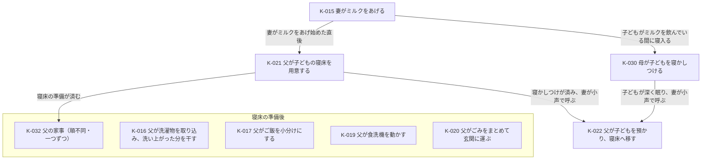

# 寝床の準備順（修正後）

> 内容確認用の草稿（draft）。矢印は対象範囲の遷移です。

家事は順不同で一つずつ進めます。子どもが深く眠り、妻が小声で呼んだら、家事の途中でも手を止めて子どもを預かります。
[入力正本](../canonical/tutorial-after.md) · [Mermaidソース](tutorial-after-flowchart.mmd)

| 関係ID | 起点 | 条件 | 終点 | 状態 |
|---|---|---|---|---|
| R-019 | K-021 | 寝かしつけが済み、妻が小声で呼ぶ | K-022 | draft |
| R-024 | K-015 | 子どもがミルクを飲んでいる間に寝入る | K-030 | draft |
| R-025 | K-030 | 子どもが深く眠り、妻が小声で呼ぶ | K-022 | draft |
| R-032 | K-015 | 妻がミルクをあげ始めた直後 | K-021 | draft |
| R-035 | K-021 | 寝床の準備が済む | K-032 | draft |
