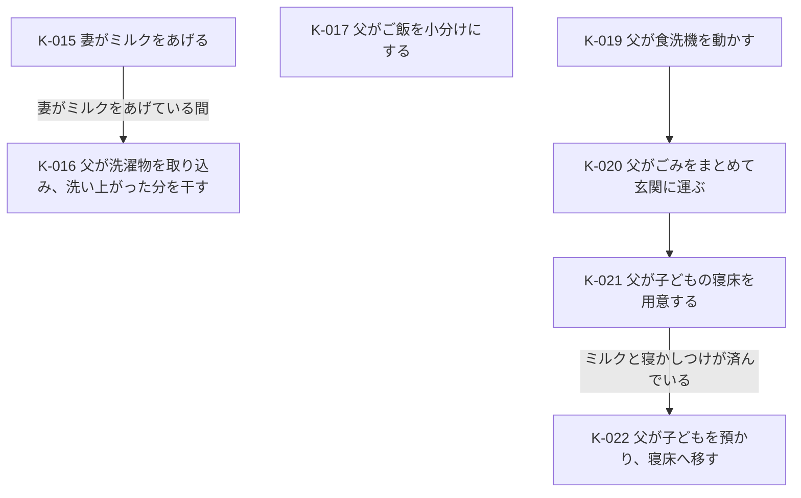

# 寝床の準備順（修正前）

> 内容確認用の草稿（draft）。矢印は対象範囲の遷移です。

修正前の草稿の図です。R-018の順番は、演習で確認する箇所です。
[入力正本](../canonical/tutorial-before.md) · [Mermaidソース](tutorial-before-flowchart.mmd)

| 関係ID | 起点 | 条件 | 終点 | 状態 |
|---|---|---|---|---|
| R-013 | K-015 | 妻がミルクをあげている間 | K-016 | draft |
| R-017 | K-019 |  | K-020 | draft |
| R-018 | K-020 |  | K-021 | draft |
| R-019 | K-021 | ミルクと寝かしつけが済んでいる | K-022 | draft |
